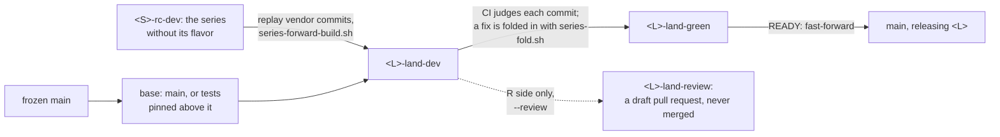

# Landing a line on `main`

*Handbook: [`operations/releases/process/`](/handbook/operations/releases/process/README.md),
the release process, of which this is the change of line.*

`main` releases one line at a time.
When the next one has a series of its own, `main` takes it by **fast-forwarding onto that series' vendor commits**:
every upstream commit the series vendored, with the R-side fix CI demanded folded into it,
replayed without the flavor onto `main` itself and judged by CI one by one.
Nothing else reaches `main`:
no flavor, no seed, and no port, because everything a port carries is `main`'s already.
The line `main` released before parks on its own baseline and keeps its series,
which from then on takes `main`'s tooling and none of its R side.

`<L>` is the line, `v2.0-cyanoptera`; `<S>` is the series that lands,
its live forward `v2.0-cyanoptera-fwd` while one exists, because that is the one standing on today's `main`.
`<P>` is the line `main` releases until the landing, `v1.5-variegata`.

## The refs



* **`<L>-land-dev`**, in the fork: `main` plus the vendor commits, and nothing else.
  CI judges it like any `-dev` ([`scripts/each-plan.sh`](/scripts/each-plan.sh)).
* **`<L>-land-green`**, in the fork: where CI's judgement starts.
  It is pushed at the frozen `main` and advanced over the commits that passed;
  the landing is ready when it equals `<L>-land-dev`.

* **`<L>-land-review`**, in the canonical repository: the same landing without its engine,
  for a draft pull request that is read and never merged (step 4).

There is no `<L>-land-build`, so the loop never mistakes the pair for a series.
All three are deleted once `main` has taken the landing.

## Before you start

* **The series is current.**
  `<S>` has taken every port of `main`, and its rc strand is aligned
  ([`series-rc`](/.claude/skills/series-rc/SKILL.md)); the build refuses an rc strand behind its source,
  and its tree check refuses a series that lacks something `main` has.
* **The convergence findings are settled**, when `<S>` is a forward
  ([`series-forward`](/.claude/skills/series-forward/SKILL.md), `scripts/series-converge.sh <L>`).
  The landing carries the forward's tree, so whatever the forward lost against its base is lost on `main` too.
* **`<P>` is declared parked** in [`scripts/series.yaml`](/scripts/series.yaml):
  its `releases_from` names its own baseline, not `main`.
  That declaration is what keeps `main`'s new R side out of `<P>`'s series
  ([`scripts/series-port.sh`](/scripts/series-port.sh)),
  because its seed sits on `main`'s own history, which no lineage test can tell from a live line's.
  It lands on `main` with `.github/pull.yml`'s rule for the baseline
  (`scripts/pull-config.sh --check`) and the regenerated badge table,
  before the freeze or as the first merge after the landing, so nothing with the new line's R side merges ahead of it.

## 1. Freeze `main`

Every commit of the landing stands on one `main` commit, so `main` must not move until it fast-forwards.
A ruleset with no bypass list stops every update, pull requests and admins included.
A human runs these, and reads each output before the next.

Inspect: the rulesets on `main`, and the commit it freezes at.

```sh
R=duckdb/duckdb-r
gh api repos/$R/rulesets --jq '.[] | [.id, .name, .enforcement] | @tsv'
gh api repos/$R/commits/main --jq .sha
```

Freeze:

```sh
gh api -X POST repos/duckdb/duckdb-r/rulesets --input - <<'EOF'
{
  "name": "freeze main",
  "target": "branch",
  "enforcement": "active",
  "bypass_actors": [],
  "conditions": {"ref_name": {"include": ["refs/heads/main"], "exclude": []}},
  "rules": [
    {"type": "update", "parameters": {"update_allows_fetch_and_merge": false}},
    {"type": "deletion"},
    {"type": "non_fast_forward"}
  ]
}
EOF
```

Verify: an `update` row from the new ruleset, and `never`.

```sh
gh api repos/duckdb/duckdb-r/rules/branches/main --jq '.[] | [.type, .ruleset_id] | @tsv'
id=$(gh api repos/duckdb/duckdb-r/rulesets --jq '.[] | select(.name == "freeze main") | .id')
gh api repos/duckdb/duckdb-r/rulesets/$id --jq .current_user_can_bypass
```

The loop keeps running: it reads `main` and writes no ref there.

## 2. Park `<P>` on the frozen `main`

The baseline is what `<P>` releases from now, so it takes the R side `main` released it with.
It is a branch of its own, outside the freeze, and it may hold commits `main` never took,
from before `<P>` released from `main`.
Read them first, keep them under a dated name, then move the baseline:

```sh
git fetch upstream main <P>
git log --oneline upstream/main..upstream/<P>
git push upstream upstream/<P>:refs/heads/<P>-before-land-$(date -u +%Y%m%d)
git push --force-with-lease=<P>:$(git rev-parse upstream/<P>) upstream upstream/main:refs/heads/<P>
```

The Pull app mirrors it into the fork within six hours ([`branches/mirrors/`](/handbook/branches/mirrors/README.md)).
A forward of `<P>` still in flight is cut over or deleted now; none is started again.

## 3. Build the landing

```sh
scripts/series-land.sh <S> --remote origin --canonical upstream          # build and check
scripts/series-land.sh <S> --remote origin --canonical upstream --push   # and write both refs
```

**Tests that pin what the line must keep go underneath, not into the series afterwards.**
A pull request of tests written on `main`'s engine, one commit on the frozen `main`,
is the landing's base: `--base <its branch>`.
Its commit lands with the vendor commits, CI judges it from `main` up,
and the tree check expects it merged into the series' package,
so the series has to carry it too before the landing can pass:
port it by name, `scripts/series-port.sh <S> --apply <sha>`.

[`scripts/series-land.sh`](/scripts/series-land.sh) replays with
[`scripts/series-forward-build.sh`](/scripts/series-forward-build.sh) in a worktree it keeps,
so everything that script stops on stops here, and a rerun resumes:

* **a conflict**: resolve it in the kept worktree the way the series resolved it, `git add`, rerun.
  rerere records the resolution, and a rebuild that meets the same conflict continues on its own;
* **a commit that vendors nothing and is not `main`'s**: decide where its change belongs and pass `--placed <sha>`.
  Ports of commits `main` already has are placed by their `-x` trailer, and tooling syncs by their subject;
* **the glue gate**: fix the glue in the commit that broke it and rerun.

The build ends with the tree check:
the landing's tip must be the package the rc strand holds,
except for `NEWS.md` and the READMEs, which are `main`'s by construction.
Anything else is something `main` has and the series lacks, or the other way round.
Fix it on the series and realign its rc strand; a rerun follows the strand from where the build stands.
Nothing is pushed until the check passes.
Two things the check cannot see are reported beside it:

* **files the landing deletes from `main`** outside the vendored strand and the tests, which the series lacks too.
  Each is a file the series lost on the way; restore it on the series before pushing.
* **resolutions rerere replayed**, named when the check fails.
  A wrong one is replayed as faithfully as a right one:
  rebuild with `--abort` and then `--attended`, which stops at every conflict with rerere's answer unstaged,
  and drop the wrong one there with `git rerere forget <path>`.

**The tests are held to the base's, and the push waits for them.**
The tree check compares the landing with the series, so a test the series stopped running passes it.
[`scripts/series-tests.sh`](/scripts/series-tests.sh) compares the landing's tests with its base's,
the frozen `main` and any tests pinned above it,
and the build refuses to push while one is lost:
a deleted file, block or snapshot entry, a skip the base does not make, or an engine gate, live or expired.
Restore each on the series in the vendor commit that took it, or take a gate out at the commit whose engine it names,
then realign the rc strand and rerun ([`operations/vendoring/series-loop/`](/handbook/operations/vendoring/series-loop/README.md)).
What a test expects may differ, and the report lists every such path with the commits that moved it,
marking one that a rewind changed and nothing put back.
A test that `main`'s engine passes and the new line's cannot is not the landing's to decide:
it is adapted in the base, written to hold on both engines, and ported to the series like any pinned test.

Committer dates are pinned to the frozen `main`'s, so a rebuild from the same inputs mints the same SHAs
and CI does not judge a commit twice.

## 4. Open the R side for review

The landing's own diff is the engine's, hundreds of thousands of lines.
What changes for `main`'s maintainers is the rest: the glue, R code and tests the series changed on the way.

```sh
scripts/series-land.sh <S> --remote origin --canonical upstream --review --push
gh pr create --repo duckdb/duckdb-r --draft --base main --head <L>-land-review \
  --title "Review: the R side of the <L> landing"
```

The run prints the build's test report as well; it belongs in the pull request's description,
because it is the one place a reviewer reads every test change the landing makes at once.

`<L>-land-review` is the frozen `main`, one commit that removes every workflow,
and one commit for each landing commit that changes anything outside the vendored strand,
carrying that change alone under the upstream commit that asked for it.
Its checks could only fail, because the R side compiles against no engine there,
and without workflow files the pull request starts nothing that builds or tests it.
It is never merged: a finding is fixed on the series, the landing is rebuilt,
and `--review --push` rewrites the branch, which the pull request follows.

**Findings converge in iterations before the series takes them.**
An iteration is a landing branch of its own, `<L>-land-v<n>`, with no `-dev` suffix so nothing builds it,
made from the previous one by folding each fix into the landing commit that introduced the defect,
so that every commit from there on carries it and every intermediate commit passes;
nothing is stacked on top of the vendor commits.
A fix is written as a commit on the commit it folds into,
and [`scripts/series-fold.sh`](/scripts/series-fold.sh) folds it there and replays everything above,
adding a note to the folded commit's message.
It is checked by the glue gate at every commit it changed and by building its tip and running the suite.
Each gets a review pull request of its own,
`--review --landing <L>-land-v<n> --suffix -v<n>`,
read by a reviewer with a clean context;
the next iteration answers what that review found, until a review finds nothing.
The fixes then go onto the series, and the landing is built from it as above.

## 5. Let CI judge every commit

Pushing `<L>-land-dev` starts the per-commit build over `<L>-land-green..<L>-land-dev`.
Read and advance it with

```sh
scripts/series-land.sh <S> --status --push
```

which moves `<L>-land-green` over the commits that passed and names the first that has not.
A red is repaired as stage 2 repairs one ([`series-loop`](/.claude/skills/series-loop/SKILL.md)):

* **the infrastructure's fault**: push `retry-<L>-land-dev` at the commit, once;
* **the tree's fault**: fix it on the series, as stage 2 would, and realign its rc strand.
  In the kept worktree, `git reset --hard` to the parent of the red commit,
  then rerun the build: it follows the realigned strand and replays from there,
  so the landing never carries a fix the series does not.

## 6. Fast-forward `main`

When `--status` prints `READY`, every commit has passed and `main` is still the commit the landing stands on.
Push the SHA that line names, not whatever the branch holds by then,
so a repair pushed in between cannot reach `main` unjudged.
Lift the freeze, push, and put it back until the step below is done:

```sh
sha=<the SHA the READY line names>
id=$(gh api repos/duckdb/duckdb-r/rulesets --jq '.[] | select(.name == "freeze main") | .id')
gh api -X PUT repos/duckdb/duckdb-r/rulesets/$id -f enforcement=disabled
git push upstream $sha:refs/heads/main
gh api -X PUT repos/duckdb/duckdb-r/rulesets/$id -f enforcement=active
git ls-remote upstream refs/heads/main
```

The push is a plain one, so git refuses it unless it is a fast-forward.
It needs the existing `main` ruleset's admin bypass, because it is not a pull request.

## 7. After the landing

Delete the freeze, so that `main` takes pull requests again:

```sh
id=$(gh api repos/duckdb/duckdb-r/rulesets --jq '.[] | select(.name == "freeze main") | .id')
gh api -X DELETE repos/duckdb/duckdb-r/rulesets/$id
```

The nightly fledge run may open its version pull request first, against a version it does not expect;
close it in favour of the one below.

The first pull request on `main`:

* **The CRAN row** in `scripts/series.yaml`: `duckdb` now tracks `<L>`.
  Regenerate the tables ([`series-open`](/.claude/skills/series-open/SKILL.md), step 6).
* **`main`'s version.** The landing ends on the series' version, `1.99.99.9000.<n>`,
  which is the preview prefix `main` carries while it previews the line
  ([`operations/releases/versioning/`](/handbook/operations/releases/versioning/README.md)).
  `main`'s own counter is the fourth component, so the first bump sets it explicitly,
  `fledge::bump_version("1.99.99.9001")`, which also drops the vendor counter.

Then the series:

* **Forward `<L>`, and the series tracking upstream `main`, onto the new `main`**
  ([`series-forward`](/.claude/skills/series-forward/SKILL.md)).
  The new seed already vendors what the landing vendored, so `<L>`'s forward replays only what came after.
* **Delete the landing**: `<L>-land-dev` and `<L>-land-green` on the fork,
  `<L>-land-review` in the canonical repository with its draft pull request closed,
  and the kept worktree with `scripts/series-land.sh <S> --abort`.
